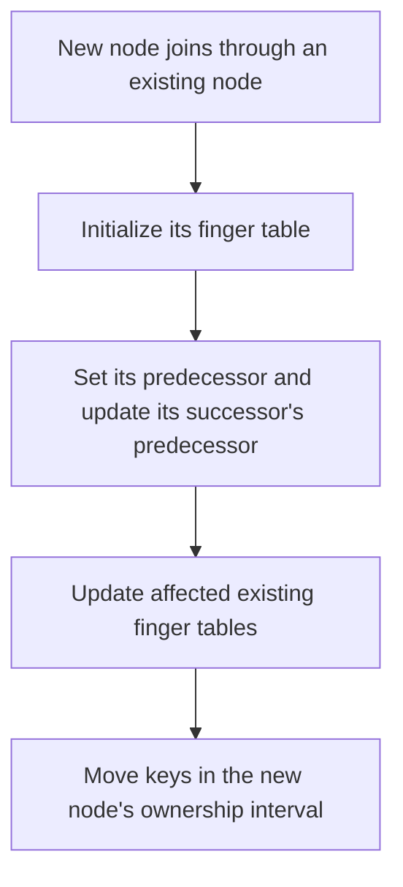

# Chord implementation: theory and fixes

This note explains how the Chord code in this project maps to the protocol in the paper, including the Figure 6 join pseudocode issue and the fixes in this implementation.

Sources: [[Chord-Paper.pdf]] and [[45402-01_FDS_data_part.pdf]] (Chord assignment, especially the Figure 6 hint).

## Core idea

Chord places node IDs and key IDs on a circular identifier space of size `2^m`. A key belongs to the first node at or clockwise after its ID:

```text
successor(keyId) = first node whose ID is >= keyId, wrapping around the ring
```

Each node keeps a finger table. For one-based finger `i`:

```text
finger[i].start = nodeId + 2^(i - 1) mod 2^m
finger[i].node  = successor(finger[i].start)
```

Finger entries let lookups jump around the ring instead of visiting every node. In a stable ring, routing takes about `O(log N)` hops for `N` nodes.

## Lookup implementation

In [`ChordPeer.java`](src/main/java/ch/unibas/dmi/dbis/fds/p2p/chord/impl/ChordPeer.java), lookup follows the Figure 4 pattern:

1. `findPredecessor(id)` walks toward the key, using the closest preceding online finger. If no finger advances the search, it takes one successor hop.
2. The current node is the predecessor when `id` lies in `(current, successor]`.
3. `findSuccessor(id)` returns that predecessor's successor.
4. `closestPrecedingFinger(id)` checks the longest fingers first.

The interval `(current, successor]` includes an ID equal to the successor, so a key whose hash equals a node ID is routed to that node. A single-node ring is handled as a special case. A hop limit detects a lookup that fails to converge.

## Joining in static mode

For a static join, `joinAndUpdate()` follows Figure 6's sequence:



The first node has no existing ring to contact, so it sets every finger and its predecessor to itself. For a later join:

- `initFingerTable()` finds the new node's successor, adopts that successor's old predecessor, and then fills the remaining fingers. A later finger can reuse the previous finger when its start is in the same finger interval; otherwise it performs a successor lookup.
- `updateOthers()` checks each offset `2^(i - 1)`, finds the predecessor of `newNodeId - offset`, and asks it to update finger `i`.
- `updateFingerTable()` changes an entry only when the joining node is now the successor of that entry's start.

The interval helper `isInClockwiseRange(start, end, value)` implements `[start, end)` on the circular ID space, including wraparound. Equal endpoints represent an empty interval for this check.

## Figure 6 pseudocode issue and correction

Figure 6 gives this update condition and predecessor recursion:

```text
if (s ∈ [n, finger[i].node))
    finger[i].node = s
    p = predecessor
    p.update_finger_table(s, i)
```

The assignment calls out the two-node bootstrap case: Node 1 joins Node 0, whose fingers initially all point to itself. In the paper's circular interval notation, `[0,0)` covers the whole ring. The condition can therefore make Node 1 replace *every* finger of Node 0, even though only finger 1 should change: the starts for higher fingers are beyond Node 1, so their successor remains Node 0.

This code instead checks the joining node against the actual finger start and the old successor:

```java
if (!isInClockwiseRange(fingerStart, oldSuccessorId, joiningNodeId)) return;
fingerTable.setNode(i, joiningNode);
```

That is, update the finger only if the joining node falls in `[fingerStart, oldSuccessor)`. This updates only finger starts for which the joining node is the new successor.

There is a related recursion issue. During initialization, the old successor's predecessor is changed to the joining node. If the update walk reaches that pointer, blindly following it can return to the joiner and miss the old predecessor. `updateFingerTable()` detects this case, skips the joiner, and continues at `joiningNode.predecessor()`.

```java
if (predecessor == joiningNode) {
    predecessor = joiningNode.predecessor();
}
```

> [!summary] Bootstrap fix
> Test each finger from its own start position, and when predecessor recursion reaches the joining node, continue from its old predecessor.

## Moving keys during a join

When a new node joins, its responsibility is the circular interval `(predecessor, newNode]`. Before the join, those keys belonged to its immediate successor.

`ownsKey()` hashes each key and checks whether its ID is in that interval. `takeKeysFromSuccessor()` snapshots the successor's keys, then uses the existing `delete()` method to remove only the keys in the new node's range while the old routing still points to the successor. After the finger tables are updated, `joinAndUpdate()` uses the existing `store()` method to route those values to their new owner. This keeps the change within the join implementation and does not add storage methods to `AbstractChordPeer`.

## Dynamic mode

The code also includes the Figure 7 stabilization operations:

- `joinOnly()` sets an initial successor and leaves predecessor discovery to stabilization.
- `stabilize()` adopts a closer predecessor reported by its successor, then notifies the successor.
- `notify()` accepts a candidate predecessor if it lies between the current predecessor and this node.
- `fixFingers()` refreshes one finger per call and cycles through all `m` entries, as in Figure 7.
- `checkPredecessor()` clears an offline predecessor. `checkSuccessor()` follows the departed successor's successor pointers until it finds a live node, or resets to a one-node ring if none remains.

The liveness checks are simulator additions, not the full failure-recovery protocol described by Chord. The code does not maintain a successor list, so recovery from arbitrary node failures is limited.

## Scope and limitations

- Static lookup, finger-table initialization, affected-finger updates, and key transfer are implemented here.
- The finger-update walk is recursive, as in Figure 6, with a guard for the joining-node predecessor pointer.
- Dynamic stabilization is educational and does not provide Chord's full failure guarantees.
- The simulator's extra departure recovery follows the failed node's stored successor pointers.

## Small launcher fix

Removed the stray standalone `*` in `ui/Main.java` that caused IntelliJ's `illegal start of type` compile error.
